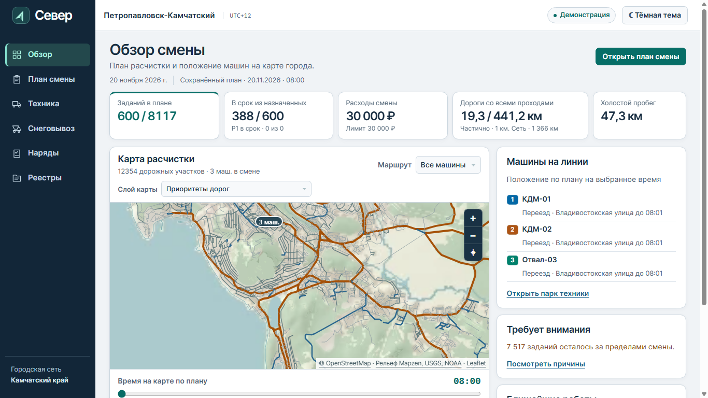

# Север · Snow Control

Диспетчерская зимней уборки Петропавловска-Камчатского. На карте видно, какая машина назначена на участок, когда она туда прибудет и какие работы останутся за пределами смены при заданном бюджете. Система предназначена для демонстрации и сравнения сценариев.

## Запуск

Требуется Node.js 24 или новее. Все ресурсы для демонстрации включены в репозиторий. Из его корня выполните:

~~~sh
npm start
~~~

Откройте адрес из терминала (по умолчанию http://127.0.0.1:8792). На Windows также можно запустить **Запустить.cmd**. Сторонние пакеты и ключи карт для запуска не нужны.

Для показа без сервера выполните **npm run demo** и откройте **dist/sever-demo.html** в Chrome или Edge. Для показа серверного журнала, договорных редакций и перепланирования запустите локальный сервер. Учебная SQLite-база создаётся при первом запуске. Каталог можно задать через SNOW_DB_DIR.

## Что показать

- **План смены и техника.** Настройте парк, тарифы, перекрытия и приоритеты. Сравните назначенные проходы, сроки и причины пропуска.
- **Снеговывоз.** Проверьте занятость погрузчика, самосвала и поста разгрузки в общем бюджете.
- **Наряды и реестры.** Проследите путь от учебного основания до отдельного решения заказчика.
- **Повторный снегопад.** Сохраните исходный план, добавьте событие и скачайте отчёт по редакции.

Скорости, тарифы, допуски и сроки сценарные. Историческое сообщение о технике требует отдельной проверки доступности на смену. Граф заданий охватывает город, фоновая карта — также окрестности Авачинской губы.

## Навигация

| Для кого | С чего начать |
|---|---|
| Жюри и докладчик | [Сценарий показа на 3 или 7 минут](docs/DEMO_SCRIPT.md) |
| Разработчик | [Архитектура и потоки данных](docs/ARCHITECTURE.md), [правила разработки](AGENTS.md) |
| Сокомандник | [Передача проекта](research/HANDOFF.md), [база знаний](knowledge/00_INDEX.md) |
| Организатор | [Проверки и перенос в репозиторий мероприятия](docs/RELEASE_CHECKLIST.md) |
| Источники карты | [Происхождение данных и атрибуция](data/CITY_SOURCES.md) |

## Проверки

~~~sh
npm test
npm run build
npm run demo
~~~

GitHub Actions выполняет эти команды на Node 24. В артефакте **snow-control-demo** успешного запуска находится автономный HTML.
